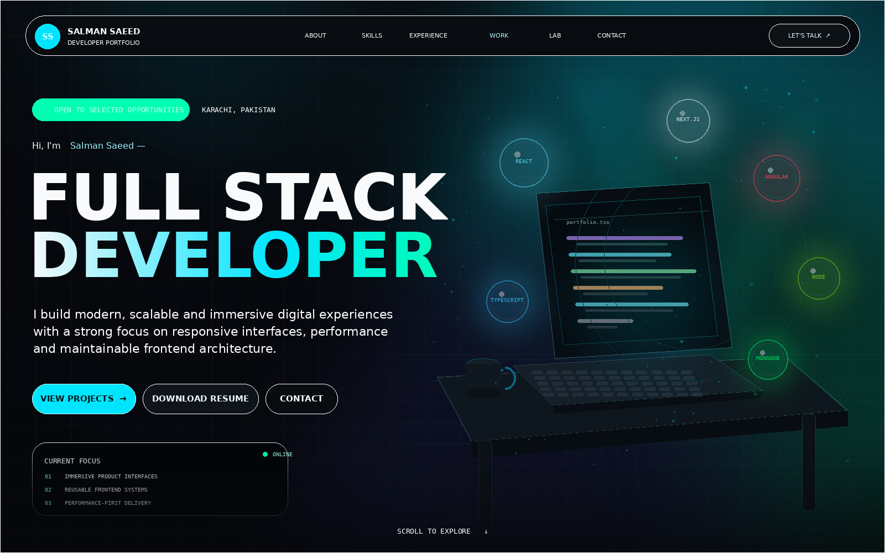

# Salman Saeed — Cinematic 3D Developer Portfolio



A production-oriented, single-page developer portfolio built with Next.js 15, React 19, TypeScript, Tailwind CSS 4, Framer Motion, GSAP, Three.js, React Three Fiber, Drei and Lenis.

The content is personalized from Salman Saeed's supplied CV. It uses verified experience, education, skills, contact details, certification and recognition data. The design deliberately uses a recognition rail instead of inventing client testimonials, and private project links remain labelled as private.

## Highlights

- Procedural WebGL hero with a futuristic desk, animated laptop and floating technology orbs
- Persistent CSS 3D hero preview so the visual remains visible while WebGL loads or is unavailable
- Real-time 3D device island with a matching non-WebGL preview for mobile and fallback states
- Mouse-driven camera movement, bloom, shadows, particles, fog and adaptive rendering
- GSAP-pinned horizontal case-study section on desktop with corrected stage sizing and section spacing
- Framer Motion reveals, counters, custom cursor, magnetic buttons and ripple interactions
- Lenis smooth scrolling synchronized with GSAP ScrollTrigger
- Responsive layouts for desktop, laptop, tablet and mobile
- Reduced-motion support and lighter effects on compact screens
- Accessible landmarks, keyboard focus states, semantic content and skip navigation
- Real GitHub data integration when a username is configured
- Server-side contact form validation, honeypot protection and basic rate limiting
- Honest contact delivery: the form never reports success unless the email provider accepts it
- Prefilled email fallback when Resend is not configured, plus direct WhatsApp and LinkedIn actions
- SEO metadata, Open Graph image, JSON-LD, sitemap, robots and web manifest
- Downloadable CV at `/Salman-Saeed-CV.pdf`

## Requirements

- Node.js 20.9 or newer
- npm 10 or newer

## Run locally

```bash
npm install
cp .env.example .env.local
npm run dev
```

Open `http://localhost:3000`.

A Windows-focused walkthrough is included in [`START_HERE_WINDOWS.md`](./START_HERE_WINDOWS.md).

For Windows PowerShell, use:

```powershell
npm install
Copy-Item .env.example .env.local
npm run dev
```

## Production checks

```bash
npm run typecheck
npm run lint
npm run build
npm start
```

## Environment variables

```env
NEXT_PUBLIC_SITE_URL=https://your-domain.com

GITHUB_USERNAME=your-github-username
GITHUB_TOKEN=

RESEND_API_KEY=
CONTACT_FROM_EMAIL="Portfolio <hello@your-domain.com>"
CONTACT_TO_EMAIL=its.salmansaeed07@gmail.com
```

### GitHub activity

`GITHUB_USERNAME` enables the public repository, star, follower, recent PushEvent and 12-week activity UI. `GITHUB_TOKEN` is optional and increases API rate limits. Without a username, the interface remains visibly labelled as preview mode and displays no invented totals.

### Contact form

The contact endpoint uses the Resend REST API without an additional SDK. Set all three email variables before deployment. When the Resend variables are absent, the form automatically opens a prefilled email instead of showing a dead-end configuration error. Provider failures still show direct email and WhatsApp options.

For a production deployment with multiple instances, replace the in-memory rate limiter in `app/api/contact/route.ts` with a shared store such as Upstash Redis.

## Personalize content

Most portfolio content is centralized in:

```text
data/portfolio.ts
```

Update that file to change:

- Personal details and availability
- Navigation
- Skills
- Experience and education
- Featured projects and public links
- Services
- Certifications and recognition

The current contact configuration uses WhatsApp `03302963342` and LinkedIn `https://www.linkedin.com/in/salman--saeed/`.

The supplied profile image is stored at:

```text
public/images/salman-portrait.png
```

The CV download is stored at:

```text
public/Salman-Saeed-CV.pdf
```

## Project architecture

```text
app/
  api/contact/          validated email delivery endpoint
  api/github/           public GitHub aggregation endpoint
  globals.css           Tailwind import and custom art direction
  layout.tsx            metadata and viewport
  page.tsx              JSON-LD and page entry
components/
  3d/                   React Three Fiber scenes
  common/               motion and interaction primitives
  layout/               navigation and footer
  providers/            Lenis and ScrollTrigger integration
  sections/             portfolio sections
  ui/                   shadcn-style UI primitives
data/                    typed portfolio content
types/                   shared TypeScript contracts
```

## Performance approach

- Heavy 3D scenes are client-only dynamic imports.
- CSS 3D previews render immediately and stay behind the WebGL canvases as a reliable visual fallback.
- No external 3D models or textures are required; the scenes use procedural geometry.
- Pixel ratio and post-processing are reduced on compact screens.
- `prefers-reduced-motion` disables continuous motion and smooth scrolling.
- Static images use `next/image`.
- GitHub requests are cached and revalidated hourly.
- The project uses route-level server handlers rather than shipping API secrets to the browser.

## Deployment

The project can be deployed to Vercel or any Node.js host supporting Next.js standalone output. Add the environment variables in the hosting dashboard, set `NEXT_PUBLIC_SITE_URL` to the final HTTPS domain, then run the production build.
